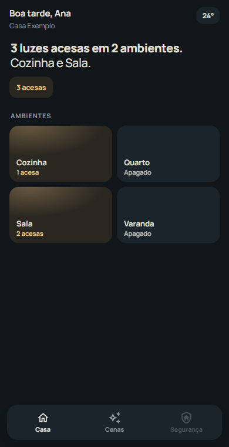
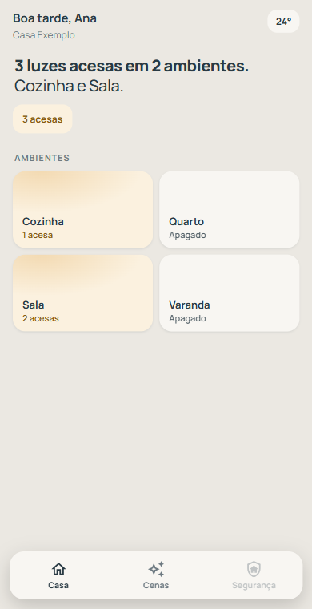
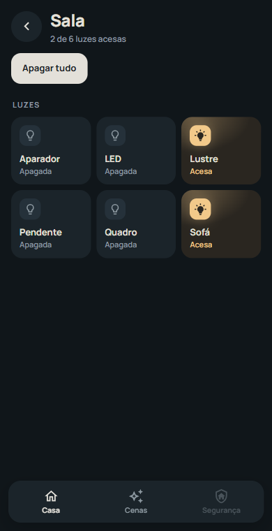
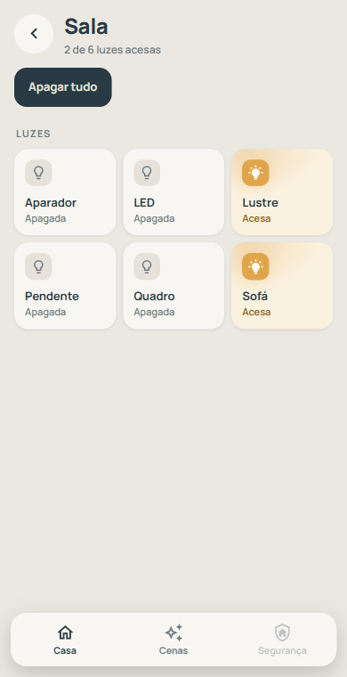

[](https://hacs.xyz/) [](https://www.home-assistant.io/) [](https://github.com/self-labs/hubb-ha-ui/releases) [](./LICENSE)

# 🏠 Hubb HA UI

A home screen your clients actually enjoy opening. One dashboard strategy builds every screen of the
house from the areas Home Assistant already knows: a sentence about the house, one card per room, the
scenes, and lights that answer the moment they are touched.

There is no card YAML per client, and the same file runs on every house, whatever board drives the
lights.

<table>
  <tr>
    <td></td>
    <td></td>
    <td></td>
    <td></td>
  </tr>
  <tr>
    <td align="center">Home, Ardósia</td>
    <td align="center">Home, Areia</td>
    <td align="center">Room, Ardósia</td>
    <td align="center">Room, Areia</td>
  </tr>
</table>

## Why this exists

A polished Home Assistant dashboard is usually built by hand, and that is where it stops scaling:

| Approach                                       | Problem                                                                                  |
| :--------------------------------------------- | :--------------------------------------------------------------------------------------- |
| Hand-built YAML (Mushroom, Bubble Card, ...)   | One copy per client: a fix has to be pasted into every house, one by one                 |
| Styling through `card-mod`                     | The premium look rides on CSS overrides that break when the frontend changes             |
| Entity ids written into the cards              | Swapping the relay board (ControlArt for KinCony, say) means rebuilding the dashboard     |
| Home Assistant's own area dashboard            | Generic look, every entity shown, nothing designed for the person living in the house    |

This takes a different route. A **dashboard strategy** (`custom:hubb`) reads the areas, devices and
entities at load time and generates the screens. The cards only receive entity ids, so the house is
described once, in Home Assistant itself, and one HACS update reaches every client.

## What the resident gets

| Screen          | What it shows                                                                                       |
| :-------------- | :-------------------------------------------------------------------------------------------------- |
| **Home**        | A greeting, the outside temperature, one sentence about the house, the first four scenes, the rooms |
| **Room page**   | The area photo, "Apagar tudo", the room's scenes and one tile per light                             |
| **Lights on**   | A sheet with every light that is on, grouped by room, and "Apagar todas"                            |
| **Scenes**      | Every scene, with the rooms it touches                                                              |

And the way it behaves:

| Interaction               | Behaviour                                                                                         |
| :------------------------ | :------------------------------------------------------------------------------------------------ |
| Tap a light               | Changes at once and vibrates; if Home Assistant does not confirm in 3 s, it says "Sem resposta"   |
| Tap a light that is down  | Says since when it stopped answering                                                               |
| Long press a dimmer       | Opens a brightness sheet: drag the column, or 25, 50, 75 and 100                                   |
| Bulk action or scene      | Runs at once and offers **Desfazer** for 5 s, restoring every light to how it was                  |
| Theme                     | Ardósia (dark) or Areia (light), following the Home Assistant profile, AA contrast in both         |
| Back                      | The in-app arrow and the Android back gesture stay in step                                         |

> [!NOTE]
> Vibration comes from the Home Assistant Companion App, which turns the frontend's `haptic` event
> into a buzz. A plain browser simply ignores it.

## Install

### HACS (recommended)

[](https://my.home-assistant.io/redirect/hacs_repository/?owner=self-labs&repository=hubb-ha-ui&category=plugin)

The button opens this repository straight in your HACS. Click **Download**. No restart is needed:
HACS registers the dashboard resource by itself.

It works through [my.home-assistant.io](https://my.home-assistant.io/), which only knows how to reach
your instance after you set your own URL there once, under **Settings → System → Network → Home
Assistant URL**. Until then it asks for it.

<details>
<summary>Doing it by hand</summary>

1. HACS → three-dot menu → **Custom repositories**.
2. URL: `https://github.com/self-labs/hubb-ha-ui`, type **Dashboard** → **ADD**.
3. Open the entry and click **Download**.

</details>

<details>
<summary>Without HACS</summary>

1. Download `hubb-ha-ui.js` from the [latest release](https://github.com/self-labs/hubb-ha-ui/releases/latest)
   into `config/www/`.
2. **Settings → Dashboards → three-dot menu → Resources → Add resource**: URL
   `/local/hubb-ha-ui.js`, type **JavaScript module**.

</details>

## Create the dashboard

[](https://my.home-assistant.io/redirect/lovelace_dashboards/)

1. **Add dashboard** and pick **Hubb** under *Community dashboards*.
2. Give it a URL with a hyphen, for example `hubb-casa` (Home Assistant requires the hyphen).
3. Open it. That is all; everything below is optional.

Or start from a blank dashboard and paste this into the raw configuration editor:

```yaml
strategy:
  type: custom:hubb
  name: Casa Exemplo
```

### Options

| Option                | Default                            | Meaning                                                    |
| :-------------------- | :--------------------------------- | :--------------------------------------------------------- |
| `name`                | The location name in Home Assistant | House name under the greeting                             |
| `scenes`              | Alphabetical                       | Scene order; the first four go to the home screen          |
| `rooms.<area>.order`  | Alphabetical                       | Room order                                                 |
| `rooms.<area>.photo`  | The area picture                   | Photo for the room card and the room page                  |
| `rooms.<area>.hidden` | `false`                            | Leaves a room out                                          |
| `hide_entities`       | none                               | Lights left out even though they have an area              |

```yaml
strategy:
  type: custom:hubb
  name: Casa Exemplo
  scenes: [scene.chegar, scene.sair, scene.noite, scene.cinema]
  rooms:
    sala_de_estar: { order: 1, photo: /local/hubb/sala.jpg }
    lavanderia: { hidden: true }
  hide_entities: [light.spot_da_garagem]
```

## Prepare the house

The strategy shows what Home Assistant knows, so the work happens in Home Assistant, once per house:

| What                      | Why                                                       | How                                                                                                   |
| :------------------------ | :-------------------------------------------------------- | :---------------------------------------------------------------------------------------------------- |
| **Every light in an area** | A light with no area is left out on purpose              | Settings → Areas, labels & zones, or the area field of each entity                                    |
| **Lights as `light.*`**   | Relays exposed as switches or helpers are not lights      | ControlArt: the [ControlArt integration](https://github.com/tompsonpecini/controlart). KinCony with Tasmota: `SetOption30 1`. Anything else: a template light |
| **Short, client names**   | The tile shows the name as is                             | "Sofá", not "Saída 1". A room name at the start or the end is dropped ("LED Sala" in the Sala shows "LED") |
| **Scenes labelled**       | Only labelled scenes and scripts reach the panel          | Label **`hubb_cena`** on a `scene.*` or `script.*`; give it an area to show it on that room too       |
| **Area pictures**         | The room card is plain without one                        | The picture field of each area                                                                        |

Hidden and diagnostic entities never show up, and neither does anything without an area, which is
why the per-browser screen lights that Browser Mod creates stay out by themselves.

## Compatibility

Requires **Home Assistant 2026.5 or newer**, the release that lists community strategies in the *Add
dashboard* dialog. Strategies themselves are an official frontend extension point since 2021.5, and
the registries the panel reads (`hass.areas`, `hass.devices`, `hass.entities` with labels) are open to
non-admin users, so residents never need admin rights.

## Responsible use

The panel runs on Home Assistant and does not hide it. Tell the client what runs underneath, keep
Home Assistant named in your proposal and handover, and never imply an affiliation with the Open Home
Foundation. To put your own mark on the login screen and the app icon, see
[ha-custom-branding](https://github.com/self-labs/ha-custom-branding), which also explains the
trademark side in detail.

## Development

```bash
npm ci
npm run check      # typecheck, tests, build
```

The single artefact is `dist/hubb-ha-ui.js`. A `vYYYY.M.R` tag publishes it as a Release asset.
Conventions for contributors and agents live in [CLAUDE.md](./CLAUDE.md).

## License

MIT. See [LICENSE](./LICENSE). Manrope, embedded in `hubb-ha-ui.js`, is under the SIL Open Font
License 1.1: see [`LICENSES/OFL-1.1-Manrope.txt`](LICENSES/OFL-1.1-Manrope.txt).

Not affiliated with, endorsed by or sponsored by Home Assistant or the Open Home Foundation.
