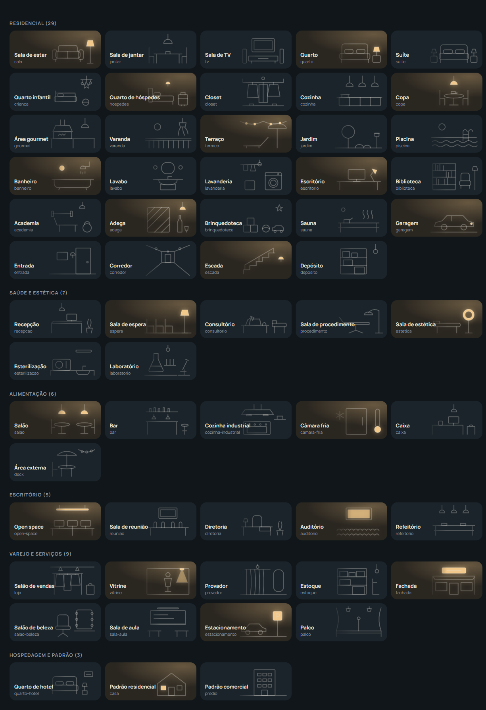

# Room drawings

A room with no photo shows one of these 59 drawings on the right of its card and of its header.
The lamp in the drawing lights up in amber while the room has a light on.



## How the panel picks one

The room name is the area name in Home Assistant, free text, set in Settings → Areas, labels &
zones. The drawing follows it:

1. `rooms.<area>.art` in the dashboard configuration, when it is one of the ids below.
2. The words of the area name, compared in lowercase, without accents and without numbers
   ("Consultório 3" reads `consultorio`). A word also matches in the plural: "s" or "es" added
   ("Vinhos", "Bares"), "ão" made "ões" ("Reuniões"), "m" made "ns" ("Jardins"). The longest match
   wins; on a tie, the word nearer the start ("Banheiro da Suíte" is a bathroom). `sala`, `quarto` and `salao` count only when nothing else matched ("Sala de Jantar"
   is a dining room), and the kind of place (`profile`) decides what they draw alone: in a
   `clinic` "Sala 3" is a `consultorio`, in an `office` an `escritorio`; in a `hotel` "Quarto 12"
   is a `quarto-hotel`; in a `salon` "Salão" is a `salao-beleza`.
3. The area icon (`mdi:sofa`, `mdi:stove`, `mdi:bed` and 155 more, listed in `src/art/resolve.ts`).
4. `casa` for a home, `predio` for every other kind of place.

To use another drawing:

```yaml
strategy:
  type: custom:hubb
  rooms:
    sala_de_estar: { art: tv }
```

An id that does not exist is ignored and the room keeps the drawing its name gives.

## The drawings

### Residential

| Id | Room | Words in the area name |
| :--- | :--- | :--- |
| `sala` | Sala de estar | `estar`, `living`, `sala` (alone) |
| `jantar` | Sala de jantar | `jantar` |
| `tv` | Sala de TV | `tv`, `home theater`, `cinema` |
| `quarto` | Quarto | `dormitorio`, `quarto` (alone) |
| `suite` | Suíte | `suite`, `master` |
| `crianca` | Quarto infantil | `crianca`, `bebe`, `infantil`, `kids` |
| `hospedes` | Quarto de hóspedes | `hospede`, `quarto de visita` |
| `closet` | Closet | `closet`, `vestir` |
| `cozinha` | Cozinha | `cozinha` |
| `copa` | Copa | `copa`, `cafe`, `cafeteria` |
| `gourmet` | Área gourmet | `gourmet`, `churrasqueira`, `churrasco` |
| `varanda` | Varanda | `varanda`, `sacada` |
| `terraco` | Terraço | `terraco`, `cobertura`, `rooftop` |
| `jardim` | Jardim | `jardim`, `quintal`, `horta` |
| `piscina` | Piscina | `piscina`, `pool` |
| `banheiro` | Banheiro | `banheiro`, `wc`, `ducha` |
| `lavabo` | Lavabo | `lavabo`, `toalete`, `toilette` |
| `lavanderia` | Lavanderia | `lavanderia`, `servico` |
| `escritorio` | Escritório | `escritorio`, `home office`, `estudio` |
| `biblioteca` | Biblioteca | `biblioteca`, `leitura` |
| `academia` | Academia | `academia`, `fitness`, `ginastica` |
| `adega` | Adega | `adega`, `vinho` |
| `brinquedoteca` | Brinquedoteca | `brinquedoteca`, `brinquedo` |
| `sauna` | Sauna | `sauna`, `spa`, `ofuro` |
| `garagem` | Garagem | `garagem` |
| `entrada` | Entrada | `entrada`, `hall`, `foyer` |
| `corredor` | Corredor | `corredor`, `circulacao` |
| `escada` | Escada | `escada` |
| `deposito` | Depósito | `deposito`, `despensa`, `almoxarifado` |

### Health and aesthetics

| Id | Room | Words in the area name |
| :--- | :--- | :--- |
| `recepcao` | Recepção | `recepcao` |
| `espera` | Sala de espera | `espera` |
| `consultorio` | Consultório | `consultorio`, `medico`, `atendimento` |
| `procedimento` | Sala de procedimento | `procedimento`, `maca`, `exame`, `massagem`, `drenagem`, `depilacao` |
| `estetica` | Sala de estética | `estetica`, `facial`, `beleza`, `laser` |
| `esterilizacao` | Esterilização | `esterilizacao`, `expurgo`, `cme` |
| `laboratorio` | Laboratório | `laboratorio`, `analise` |

### Food and drink

| Id | Room | Words in the area name |
| :--- | :--- | :--- |
| `salao` | Salão | `mesa`, `restaurante`, `salao` (alone) |
| `bar` | Bar | `bar`, `balcao`, `drink` |
| `cozinha-industrial` | Cozinha industrial | `cozinha industrial`, `producao` |
| `camara-fria` | Câmara fria | `camara fria`, `freezer`, `refrigeracao` |
| `caixa` | Caixa | `caixa`, `checkout`, `pagamento` |
| `deck` | Área externa | `area externa`, `deck`, `mesa externa` |

### Office

| Id | Room | Words in the area name |
| :--- | :--- | :--- |
| `open-space` | Open space | `open space`, `estacao`, `estacoes`, `baia` |
| `reuniao` | Sala de reunião | `reuniao`, `meeting` |
| `diretoria` | Diretoria | `diretoria`, `presidencia`, `gerencia` |
| `auditorio` | Auditório | `auditorio`, `treinamento` |
| `refeitorio` | Refeitório | `refeitorio`, `cantina` |

### Retail and services

| Id | Room | Words in the area name |
| :--- | :--- | :--- |
| `loja` | Salão de vendas | `loja`, `venda`, `showroom`, `show room` |
| `vitrine` | Vitrine | `vitrine` |
| `provador` | Provador | `provador` |
| `estoque` | Estoque | `estoque` |
| `fachada` | Fachada | `fachada`, `letreiro` |
| `salao-beleza` | Salão de beleza | `salao de beleza`, `cabeleireiro`, `barbearia` |
| `sala-aula` | Sala de aula | `aula`, `classe`, `sala de aula` |
| `estacionamento` | Estacionamento | `estacionamento`, `vaga` |
| `palco` | Palco | `palco`, `show`, `evento` |

### Hotel and defaults

| Id | Room | Words in the area name |
| :--- | :--- | :--- |
| `quarto-hotel` | Quarto de hotel | `apartamento`, `hotel` |
| `casa` | Padrão residencial | default when nothing matches |
| `predio` | Padrão comercial | default of every `profile` other than `home` |
